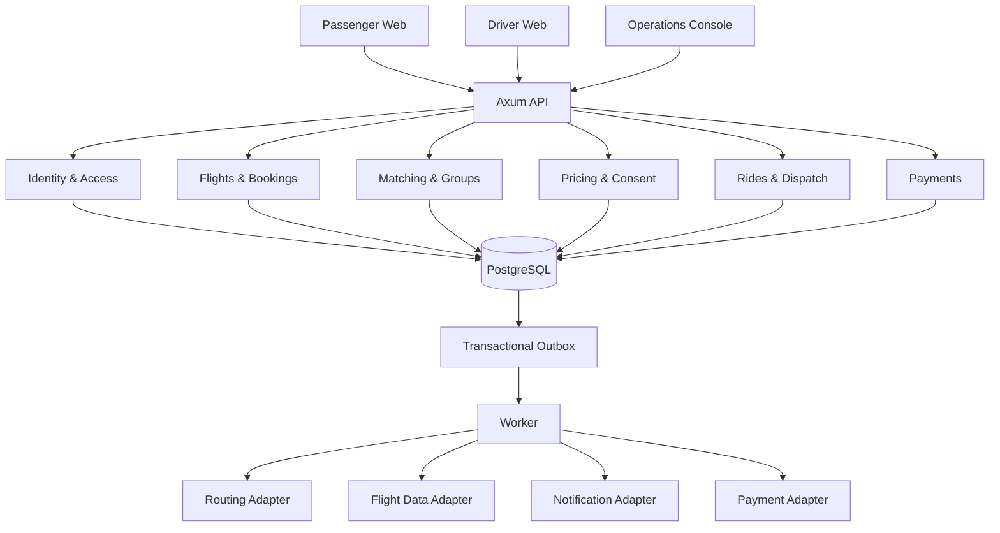

# FlightPool Architecture & System Design v1.0

**Status:** Proposed engineering baseline based on approved product decisions. This is not yet a production implementation.

## 1. MVP scope and approved constraints

- BLR inbound airport-to-city service area; same-flight matching only.
- Booking opens 24 hours before scheduled arrival; new group formation closes 30 minutes before estimated pickup.
- Maximum four passengers per group; a booking party is never split; minimum two independent booking parties for pooled confirmation.
- Maximum additional detour: 15 minutes for each passenger. Maximum matching wait: 10 minutes per booking.
- Matching runs on booking events plus a configurable 30–60 second polling cycle.
- Group membership freezes after confirmation; one active group per booking.
- All required fare consents are needed before confirmation; no silent fare changes.
- Flight delays are revalidated before dispatch. No driver availability escalates to operations; no silent solo conversion.
- Driver offer acceptance window: 60 seconds.
- Store money as integer paise and instants as `TIMESTAMPTZ` in UTC.

Still open: BLR service polygon, airport pickup authorization, vehicle/luggage capacity matrix, pricing policy, exact cancellation/no-show/grace/retry rules, payment provider, routing provider, legal retention schedule and privacy/legal review.

## 2. Architecture decision

Use a **modular monolith**: one Rust/Axum API, one PostgreSQL database, one background worker process from the same Rust codebase, and a React/TypeScript frontend. External providers sit behind adapters. Do not introduce microservices, Kafka, Redis or Kubernetes for the initial MVP.

## 3. Module ownership

| Module | Owns |
|---|---|
| identity | users, profiles, authentication, authorization |
| flights | flight instances and flight status events |
| bookings | booking requests, party and preferences |
| matching | eligibility, candidates, route compatibility, group membership |
| pricing | fare calculation, immutable quote versions, consent |
| dispatch | driver offers, acceptance, reassignment |
| rides | pickup, OTP, trip state and stops |
| payments | collection attempts, refunds, payment review |
| operations | audited overrides and support cases |
| infrastructure | database, outbox, routing/flight/payment/notification adapters |

Modules should call each other's service interfaces rather than directly mutating another module's tables.

## 4. Key workflows

### Booking
1. Authenticate passenger and validate ownership.
2. Validate flight, booking window, service area, party size, luggage and vehicle preference.
3. Insert booking and booking-passenger rows in one transaction.
4. Insert `booking.created` outbox event in that same transaction.
5. Matching is triggered by the booking event and periodic worker scan.

### Matching and proposal
1. Filter by same flight, forming group, cutoff, party seats, luggage and vehicle compatibility.
2. Routing adapter supplies direct and combined road route estimates.
3. Reject any candidate whose per-booking detour exceeds 15 minutes.
4. Rank only valid candidates; scoring weights must be documented and tested.
5. Lock selected group with `SELECT ... FOR UPDATE`.
6. Create immutable proposal membership/route snapshot and passenger-specific fare quote versions.
7. Collect all required fare consents.
8. Confirm only when at least two distinct booking parties and all required consents are satisfied; freeze membership in the same transaction.

### Dispatch and ride
1. Create ride and dispatch outbox event transactionally.
2. Offer to verified, eligible, available drivers.
3. Persist every offer, rejection, timeout and acceptance.
4. Enforce 60-second deadline in the worker/server, not the browser.
5. Atomically claim the driver and ride assignment.
6. Require readiness and valid, expiring OTP before trip start.
7. Persist completion before payment collection.

### Payment
1. Create payment record and idempotency key.
2. Call provider outside DB transaction.
3. Verify webhook signature and idempotently record result.
4. Store every attempt separately.
5. Repeated failure creates payment review case and leaves outstanding balance.
6. Refunds and driver ledger entries remain separately auditable.

## 5. Independent state lifecycles

- Booking: `REQUESTED`, `WAITLISTED`, `PROPOSAL_PENDING`, `CONFIRMED`, `CANCELLED`, `EXPIRED`.
- Group: `FORMING`, `PROPOSAL_PENDING`, `CONFIRMED`, `DISPATCHING`, `DRIVER_ASSIGNED`, `NEEDS_SUPPORT`, `EXPIRED`, `CANCELLED`.
- Ride: `PENDING_DISPATCH`, `DRIVER_ASSIGNED`, `PICKUP_READY`, `DRIVER_ARRIVED`, `OTP_VERIFIED`, `IN_PROGRESS`, `COMPLETED`, `CANCELLED`, `NO_SHOW`.
- Payment: `PENDING`, `PROCESSING`, `PAID`, `FAILED`, `REVIEW_REQUIRED`, `PARTIALLY_REFUNDED`, `REFUNDED`.

A PostgreSQL enum constrains possible values; Rust domain services enforce valid transitions. Do not collapse these lifecycles into one status column.

## 6. Consistency and concurrency

- SQLx transactions for multi-row changes.
- Lock group row with `FOR UPDATE` for membership and confirmation.
- Partial unique indexes for one active group per booking and one active assignment per driver.
- Transactional validation for group seat total, independent party count and luggage capacity.
- Idempotency keys for externally retried requests and webhooks.
- Transactional outbox with lease, attempts, retry schedule and dead-letter state.
- Never hold a database transaction open during routing, flight, SMS or payment provider calls.
- Start with `READ COMMITTED`, explicit row locks and unique constraints. Add `SERIALIZABLE` only if tests justify it and implement retry handling.

## 7. Security and privacy

- Store a keyed hash of PNR/booking reference for lookup; do not log raw references.
- Encrypt exact address before persistence; store ciphertext/nonce separately from coordinates.
- Do not log OTPs, tokens, exact addresses, PNRs or payment secrets.
- Store OTP verifier/hash, expiry and attempt count, never plaintext OTP.
- Enforce ownership and roles server-side on every endpoint.
- Admin overrides require reason, actor, timestamp and before/after audit record.
- Store driver documents in private object storage; DB stores opaque reference and verification metadata.
- Define retention/deletion schedule and applicable privacy/legal obligations before launch.
- Use TLS, managed secrets, key rotation and least-privilege DB credentials.

## 8. Provider adapters

Define Rust traits for `RoutingProvider`, `FlightStatusProvider`, `PaymentProvider`, `NotificationProvider` and `Clock`. Begin with deterministic fake adapters and contract tests. Routing results should retain provider, fetched-at timestamp, distance, duration and version/snapshot to make detour and fare calculations explainable.

## 9. Deployment

Development: Vite web app, Axum API, Rust worker, PostgreSQL 16+ via Docker Compose. Pilot: TLS reverse proxy, stateless API replicas, worker(s) using DB leasing, managed PostgreSQL with backup/PITR, private document storage, centralized logs/metrics/traces. Kubernetes is not required for the first pilot.

## 10. Observability

Structured logs include request ID and safe booking/group/ride IDs. Metrics: booking validation failures, matching queue age, candidate rejection reasons, routing latency, proposal consent conversion, group expiry, driver acceptance/timeout/reassignment, pickup wait, trip duration, payment success/failure/refund, outbox backlog and oldest event age.

## 11. Coding milestones and gates

| Milestone | Deliverable | Exit gate |
|---|---|---|
| M0 | Repo, config, Docker Compose, health endpoints, CI | Fresh clone runs API, worker and DB |
| M1 | SQLx migrations, repositories, test DB | Empty DB migrates; constraints and concurrency tests pass |
| M2 | Identity and flight fixtures | Role/ownership and flight event tests pass |
| M3 | Booking lifecycle | Booking window, party, cancellation and waitlist tests pass |
| M4 | Matching and groups | Detour, capacity, party-count and last-seat race tests pass |
| M5 | Pricing and consent | Immutable quotes; no silent fare change |
| M6 | Dispatch and rides | 60-second timeout, reassignment, OTP and active-driver tests pass |
| M7 | Payments and operations | Idempotent webhooks, retries, refunds and audit tests pass |
| M8 | Pilot hardening | Security, load, backup/restore, legal and airport approvals complete |

## 12. Explicitly unresolved before real pilot

Service polygon; airport commercial pickup authorization; verified capacity matrix; fare/toll/tax/cancellation/no-show/commission rules; driver retry policy; waitlist expiry details; grace period; payment provider semantics; PNR data provider and permissions; retention schedule; routing provider SLA and fallback. Do not launch real rides until validated.
